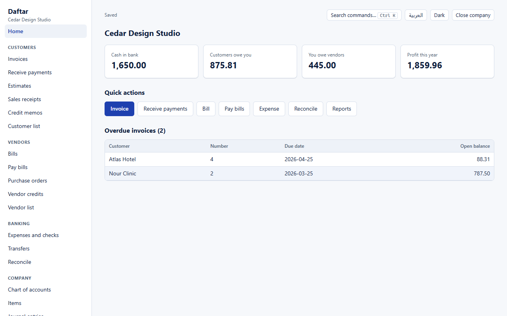
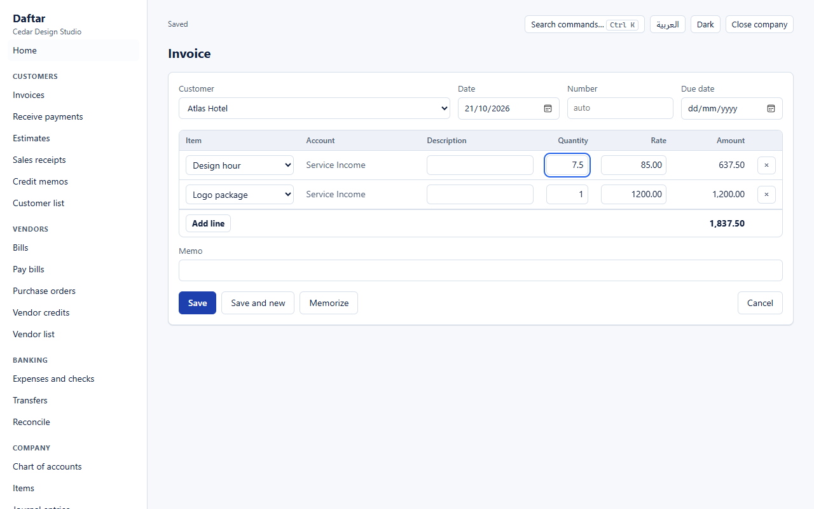
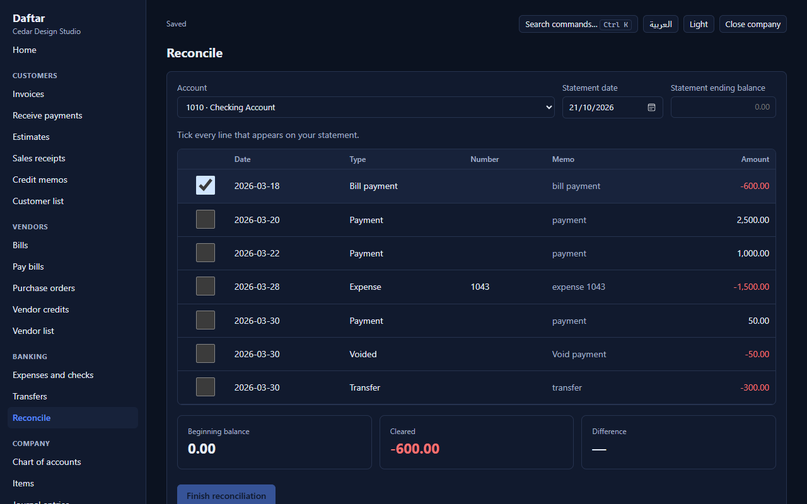
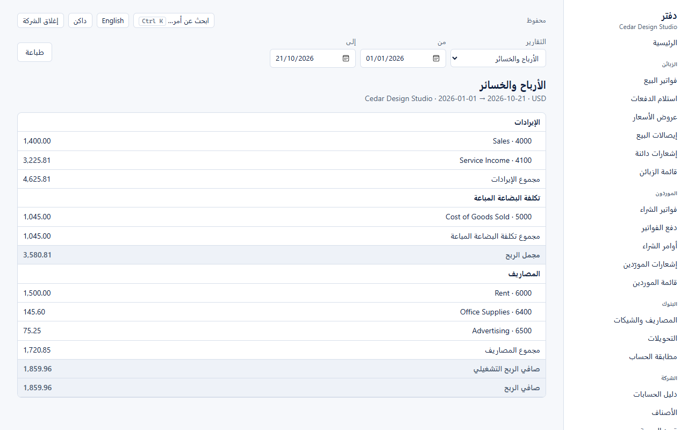

# Daftar

**Open-source accounting for small businesses that stays on your computer.** Daftar follows the
workflows people know from QuickBooks Desktop (invoices, bills, payments, bank reconciliation, the
standard reports) and runs in the browser or installs as an app, with no account, no server and no
internet needed.

*Daftar (دفتر) is Arabic for "ledger". It is a working name.*



> **Status: early.** The accounting core is complete for a service business and heavily tested;
> inventory, sales tax, multiple currencies and payroll are not built yet (see [Roadmap](#roadmap)).
> Read the [limits](#what-it-does-not-do-yet) before trusting it with real books.

## Why

QuickBooks Desktop has been moving to subscriptions: Intuit stopped selling new Desktop Plus
subscriptions in 2024, and renewals have kept rising. The main open-source desktop alternative,
Frappe Books, archived its desktop app in October 2026. Daftar aims to fill that gap: an accounting
program you own, whose file is yours, that works the way small-business bookkeepers already work.

## What it does

- **Sales:** estimates, invoices, sales receipts, credit memos; receive payments and apply them to
  several invoices; partial payments; overpayments kept as customer credit.
- **Purchases:** purchase orders, bills, vendor credits, pay bills, checks and expenses, transfers.
- **Banking:** reconcile bank and credit card accounts against a statement; undo the last
  reconciliation; reconciliation report.
- **Reports:** profit and loss, balance sheet, statement of cash flows, trial balance, general
  ledger, A/R and A/P aging, customer and vendor balances, open invoices, unpaid bills.
- **Recurring transactions:** memorize an invoice, bill or expense and run it weekly, monthly,
  quarterly or yearly.
- **Moving in:** import a QuickBooks IIF file (lists and transactions), opening balances from CSV
  reports (trial balance, open invoices, unpaid bills), and customer, vendor, item and account
  lists from CSV. Export back to IIF.
- **Arabic and English**, right-to-left and left-to-right, light and dark. Three-decimal currencies
  (JOD, KWD, BHD, OMR) are first-class; Arabic digits are accepted in every amount.
- **Every action is a named command** (press <kbd>Ctrl</kbd>+<kbd>K</kbd>), so anything a person
  can do, a script or an AI agent can do through the same door.

| | |
|---|---|
|  |  |
|  | |

## How correctness is enforced

People will run real businesses on this, so a wrong number is treated as worse than a missing
feature. The rules are written down in [`CLAUDE.md`](CLAUDE.md) and checked by tests:

- Money is an integer count of the currency's smallest unit. Nothing is ever a float, and nothing
  is rounded except quantity × rate, half away from zero, computed with BigInt.
- Every journal entry balances or is refused. Posted entries are never edited or deleted; mistakes
  are reversed or voided. Closed periods stay closed.
- Receivables and payables move only through documents, so the receivables account always equals
  the customer balances and the open invoices minus unapplied credits, at every date.
- Every report is computed from the journal; nothing is stored that could drift.
- **Golden books:** a bakery in Jordanian dinars, a design studio in US dollars, and a QuickBooks
  IIF file were computed by hand first; every report must match them to the last fils or cent.
- **Property tests:** thousands of random companies keep every identity (trial balance, balance
  sheet, cash flow, the three-way receivables tie, reconciliation, IIF round trip).
- **Adversarial review:** after each milestone a separate agent tried to break the numbers. Every
  confirmed finding was fixed and has its own regression test (`core/test/refuted*.test.ts`).
- **Integrity check:** `core/integrity.ts` verifies every assumption the core makes; a company file
  must pass it to open, and every random test asserts it.

114 tests run in about three seconds: `npm test`.

## Try it

Requires Node 24.

```bash
npm install
npm run dev
```

Open the printed address and choose **Try the sample company**. For a production build that works
offline and can be installed from the browser's address bar:

```bash
npm run build
npx vite preview app
```

To build the Windows installer (`release/Daftar-Setup-<version>.exe`) and check the packaged program:

```bash
npm run dist:win
node scripts/desktop-smoke.ts
```

The installer is not code-signed yet, so Windows SmartScreen warns before the first run.

Your company is saved in the browser on your computer (IndexedDB), with the last 20 versions kept.
Settings → *Download backup file* saves a `.daftar` file you can keep anywhere.

### Moving from QuickBooks Desktop

1. In QuickBooks: *File → Utilities → Export → Lists and transactions to IIF files*.
2. In Daftar, on a new company with an empty chart of accounts: *Company → Import → QuickBooks file
   (IIF)*, check the preview, then import.

Transactions that match a document (invoice, bill, payment, check…) become that document; anything
else comes in exactly through an *Import clearing* account that nets to zero. QuickBooks does not
record which payment paid which invoice in IIF, so payments are applied to the oldest open invoices.

## What it does not do yet

Inventory quantities and costing · sales tax / VAT · multiple currencies · payroll · several users
on one company · bank feeds · budgets · printing invoices to PDF · a Frappe Books importer (its file
format is defined by AGPL code, which this clean-room project does not read).

The QuickBooks feature list in [`catalog/`](catalog/PARITY.md) (57 of 150 features delivered) was
drafted from general knowledge of the product and is not yet checked entry by entry against
Intuit's public help pages.

## Roadmap

VAT for the UAE and Saudi Arabia (including Saudi e-invoicing) · inventory · multiple currencies ·
printable invoices and statements · a signed installer, and macOS and Linux packages · several users.

## Contributing

Read [`CLAUDE.md`](CLAUDE.md) first: it is the working agreement for people and agents alike. Every
change comes with tests; anything that touches numbers comes with a golden-book or property test.

```bash
npm run check   # typecheck, tests, parity floor
```

## Clean room

Daftar is written from scratch. No code is taken from QuickBooks or from any GPL/AGPL project.
QuickBooks file support is based on Intuit's published IIF format and on files QuickBooks exports.
All icons and images are original.

QuickBooks is a trademark of Intuit Inc. Daftar is an independent project and is not affiliated
with, sponsored by or endorsed by Intuit; the name is used only to describe compatibility.

## License

To be chosen before the first public release.
